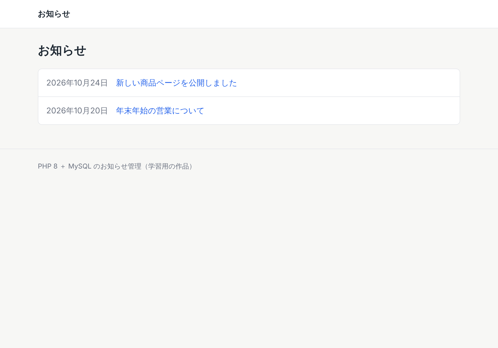
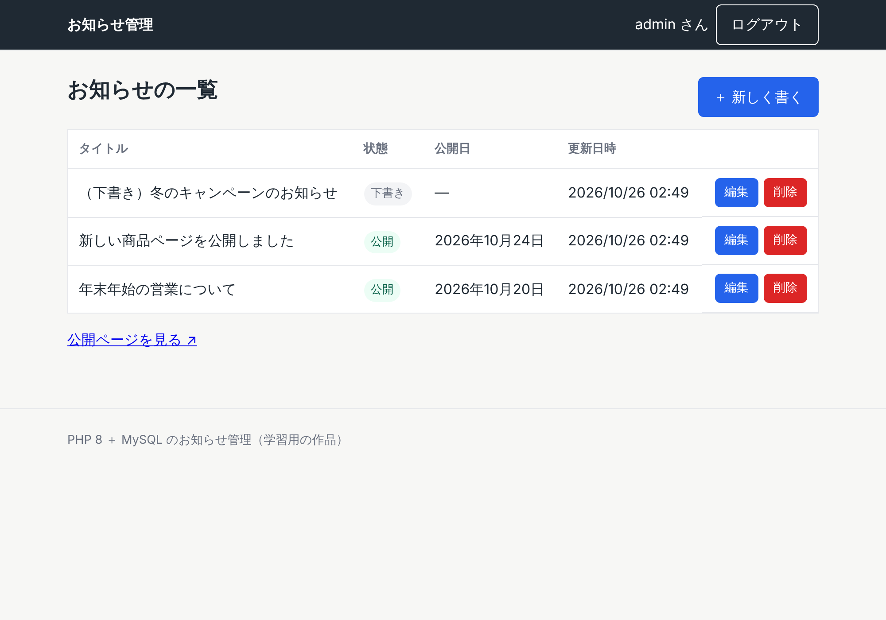
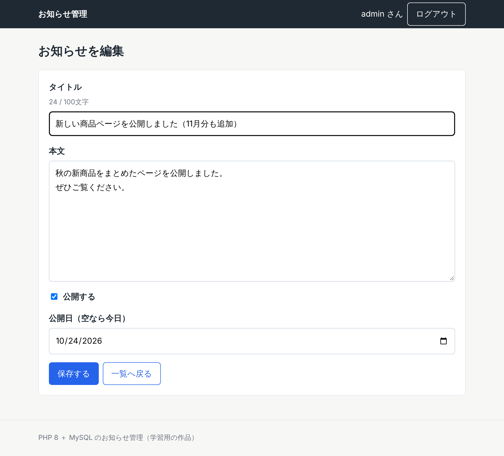
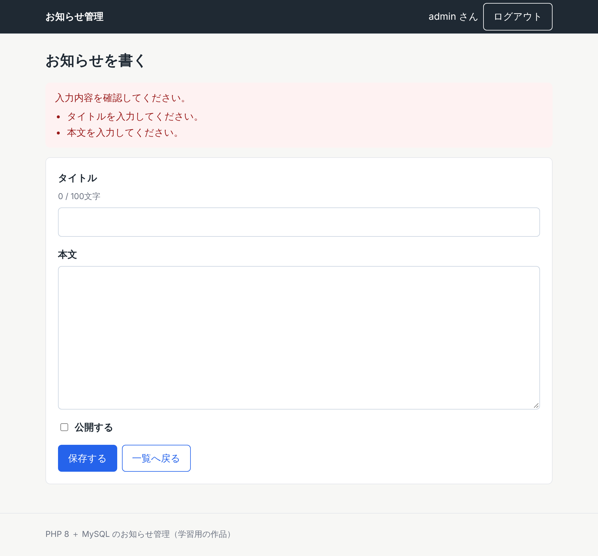

# お知らせ管理（PHP ＋ MySQL のミニCMS）

会社やお店のサイトに載せる「お知らせ」を、管理画面から書いて公開できる小さなCMSです。
PHP と MySQL の基本（データベースの読み書き、ログイン、フォームの入力チェック、安全対策）を身につけるために作りました。

## 画面

| 公開ページ | 管理画面（一覧） |
|---|---|
|  |  |

| 編集画面 | 入力エラー |
|---|---|
|  |  |

ほかの画面: [詳細ページ](docs/screenshots/02-public-detail.png) ／ [ログイン](docs/screenshots/03-admin-login.png) ／ [スマホ幅](docs/screenshots/07-public-list-mobile.png)

## できること

- **公開ページ**: 公開中のお知らせを新しい順に一覧表示。タイトルを押すと詳細ページ。
- **管理画面**（ログインが必要）
  - 一覧（下書きも表示）、新規作成、編集、削除
  - 公開／下書きの切り替え
  - 公開日の指定（未来の日付にすると、その日になるまで公開ページに出ない）
  - 入力チェック（タイトル100文字・本文5000文字まで、日付の形）

## 使った技術

- PHP 8.3（フレームワークなし）
- MySQL 8.0（PDO で接続）
- jQuery 3.7.1（削除前の確認、タイトルの文字数表示、公開日の欄の出し入れ）
- HTML / CSS（スマホ幅にも対応）
- Git / GitHub

## ファイル構成

```
public/                 ブラウザから見える場所（ドキュメントルート）
  index.php             公開ページ：お知らせ一覧
  news.php              公開ページ：お知らせの詳細
  admin/
    login.php           ログイン
    logout.php          ログアウト
    index.php           管理画面：一覧
    edit.php            管理画面：新規作成・編集（入力チェックつき）
    delete.php          管理画面：削除（POST だけ受け付ける）
  assets/               CSS・JavaScript（jQuery）
src/                    ブラウザからは見えない場所
  config.php            接続情報（環境変数から読む）
  db.php                MySQL への接続（PDO）
  news.php              お知らせの読み書き（SQL）と入力チェック
  functions.php         エスケープ・CSRF・ログインなどの共通処理
  view.php              共通のヘッダー・フッター
database/
  schema.sql            テーブルの定義
  seed.sql              動作確認用のサンプルデータ
bin/create_admin.php    管理者ユーザーを作るコマンド
tests/                  テスト
```

## 安全のための工夫

| 守りたいこと | やったこと | 場所 |
|---|---|---|
| SQLインジェクション | SQL に値を直接つなげず、プリペアドステートメント（`:id` などのプレースホルダ）で渡す | `src/news.php` |
| XSS（画面への悪いスクリプトの埋め込み） | 画面に出す文字は必ず `h()`（`htmlspecialchars`）を通す | `src/functions.php` ほか全画面 |
| CSRF（他サイトからの勝手な送信） | フォームにトークンを埋め込み、送信時に照合する | `src/functions.php` |
| パスワードの漏えい | `password_hash()` の結果だけを保存。パスワードはソースコードに書かない | `bin/create_admin.php` |
| セッションの乗っ取り | ログイン時にセッションIDを作り直す。クッキーは HttpOnly・SameSite=Lax | `src/functions.php` |
| うっかり削除 | 削除は POST だけ受け付け、jQuery で確認を出す | `public/admin/delete.php` |
| DBの権限 | アプリ用ユーザーには SELECT/INSERT/UPDATE/DELETE だけを与える | 下の「動かし方」 |

## 動かし方

PHP 8.1 以上と MySQL 8.0 が必要です。

```bash
# 1. データベースとアプリ用ユーザーを作る（パスワードは自分で決める）
mysql -uroot -e "CREATE DATABASE news_cms CHARACTER SET utf8mb4;
  CREATE USER 'news_cms'@'localhost' IDENTIFIED BY 'ここにパスワード';
  GRANT SELECT, INSERT, UPDATE, DELETE ON news_cms.* TO 'news_cms'@'localhost';"

# 2. テーブルとサンプルデータを入れる
mysql -uroot news_cms < database/schema.sql
mysql -uroot news_cms < database/seed.sql

# 3. 接続情報を環境変数で渡す
export DB_HOST=localhost DB_NAME=news_cms DB_USER=news_cms DB_PASS='ここにパスワード'

# 4. 管理者を作る（パスワードを聞かれます）
php bin/create_admin.php admin

# 5. 起動して http://127.0.0.1:8000/ を開く（管理画面は /admin/）
php -S 127.0.0.1:8000 -t public
```

## テスト

```bash
php tests/validate_test.php                                   # 入力チェックとエスケープ（14件）
ADMIN_ID=admin ADMIN_PASS='…' bash tests/http_test.sh         # 起動した状態で画面を通して確認（20件）
```

`http_test.sh` では、ログイン・作成・編集・削除・ログアウトのほか、
「`<script>` を入れたタイトルがエスケープされて表示されるか」「トークンなしの送信を断るか」「GET での削除を断るか」も確かめています。
2026年10月26日に、両方とも全件OKを確認しました。

## 作り方について

AI（Claude Code）を使って作りました。動かして画面と自動テストで確かめながら仕上げています。
PHP と MySQL は、この作品を通して学んでいるところです。

## 次に足したいこと

- 一覧のページ送り
- 画像の添付
- ログインの失敗回数の制限
